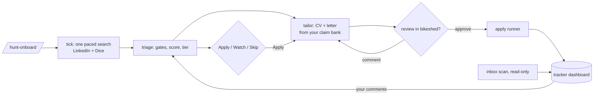

# jobba-hunt

**A job hunt that runs itself politely, and asks you before anything that matters.**

jobba-hunt is a folder you clone. It holds agent skills and plain Node scripts that:

- sweep LinkedIn and Dice on a schedule
- score each role against your own rubric
- write a CV and cover letter for every job, using only claims you confirmed
- apply where you said yes
- read your inbox without touching it
- keep a live dashboard you can comment on

It is built for Claude Code. Other agent harnesses can run every step by hand.

> If you have ever had 47 job tabs open and one of them was the CV you meant to send, this is for you.

---

## How it works



| Stage | What happens | Skill / command |
|---|---|---|
| Onboard | Your CV and letters become a confirmed **claim bank**. A short interview sets your targets, rates, schedule and logins | `/hunt-onboard` |
| Tick | One paced, read-only search per source, about every 30 minutes in your hours | `npm run tick`, `npm run dice-tick` |
| Triage | Gates (structure, location, seniority, honesty), then a 0-100 score and tier A/B/C | `/hunt-triage` |
| Tailor | A CV and letter for this job, optimised against the posting's own terms, claims only | `/hunt-tailor` |
| Review | New tailored documents go to a private bikeshed doc. You approve or comment | tracker + `npm run watch` |
| Apply | The runner fills Easy Apply, Dice and ATS forms, and stops on anything it can't answer | `npm run apply` |
| Inbox | New hunt mail becomes cards with drafts. You do the sending | `npm run mail` |
| Track | One dashboard: applications, what needs you, rejections, loop health, recent activity | `npm run tracker` |
| Loop | All of the above, self-scheduled through your working day | `/loop /hunt-loop` |

## What it will never do

- **Talk on your behalf.** No messages, connection requests, follows, likes or profile edits. You send every email yourself.
- **Make things up.** Every sentence in a CV, letter or answer traces to a claim you confirmed. A missing skill is listed as a gap, never patched in.
- **Apply without a yes.** Only roles you answered "Apply" to, or roles that pass a standing rule you opted into. It never applies twice.
- **Solve a CAPTCHA.** It's a robot that knows its place. Bot checks are handed to you.
- **Lie about being a robot.** If a form asks whether an AI is applying for you, the role comes to you to submit.
- **Push past its limits.** It keeps daily caps and pauses between page loads. Any warning sign stops it, with no retries. Recruiters get enough spam already.
- **Leak your data.** Everything personal lives in `workspace/`, which git ignores. A pre-commit hook checks the rest of the repo for your details.

## Requirements

| | What | How to get it |
|---|---|---|
| Required | Node.js 20 or newer (`.nvmrc` pins 22) | [nvm](https://github.com/nvm-sh/nvm), [fnm](https://github.com/Schniz/fnm), Homebrew, or your OS package manager |
| Required | git | macOS: `xcode-select --install`. Linux: your package manager |
| Required | macOS, or a Linux desktop with a display | Logins and first dry runs happen in a visible browser window |
| Required | about 1.5 GB of disk | Mostly the bundled Chromium |
| Bundled | Chromium (CloakBrowser), Playwright, bikeshed CLI, Google Workspace CLI, PDF and DOCX tooling, fonts | `./bin/bootstrap` installs them into this folder |
| Optional | 1Password CLI (`op`) | Lets the runner create ATS accounts with generated passwords. [Install](https://developer.1password.com/docs/cli/get-started/) |
| Optional | Python 3.8+ | Only for `authentic-prose`'s optional metrics script (stdlib only). System `python3`, or `uv run` |
| Optional | A Gmail connector in your agent | The `bridge` mail adapter, instead of the bundled Google Workspace CLI |
| Optional | firecrawl or Perplexity tools in your agent | Richer company research. Without them, research uses the agent's built-in web search |

Nothing is installed globally. The Chromium download, CLI credentials and your workspace all live inside this folder.

## Quickstart

```sh
git clone <your-copy-of-this-repo> jobba-hunt
cd jobba-hunt
./bin/bootstrap        # checks the host, npm ci, downloads Chromium, links skills, runs doctor
claude                 # open the folder in Claude Code (or your harness)
```

Then, inside the agent:

```
/hunt-onboard          # about an hour: documents, claims, interview, logins, CVs, searches
/loop /hunt-loop       # start the hunt; it schedules itself through your working hours
```

`/hunt-onboard` can be resumed: stop at any phase and it picks up where you left off. Step-by-step instructions for each OS, with checkpoints, are in [docs/setup.md](docs/setup.md).

## Skills

Skills live in `.agents/skills/`. Each one is symlinked into `.claude/skills/` so Claude Code finds it. `npm run skills:link` repairs the links.

| Skill | What it does | Needs |
|---|---|---|
| `hunt-onboard` | Builds your workspace: documents, claim bank, interview, logins, CVs, first probe | bundled tools |
| `hunt-loop` | One loop firing: ticks, triage, auto-apply, questions, applies, inbox, tracker, next wakeup | Claude Code (ScheduleWakeup, Monitor, push notifications) |
| `hunt-triage` | Scores new roles against `fit-profile.md`; writes the daily digest | none |
| `hunt-tailor` | Per-job CV and cover letter from the claim bank, measured against the posting | bundled tools |
| `hunt-kit` | Company research, fit matrix, intro note, claim sources for one role | the agent's web search; firecrawl or Perplexity if present |
| `hunt-status` | Pipeline board, follow-through, the proposal handoff | none |
| `hunt-probe` | Tests a new search query set against rules written before the data | a signed-in browser profile |
| `hunt-interview` | Screen brief before a call, debrief after | the agent's web search |
| `hunt-recruiter` | A recruiter's curated role list: one tailored CV per role, shareable pages | bikeshed |
| `authentic-prose`, `humanizing-prose` | Every outbound sentence goes through these, in your voice | none (`metrics.py` optional) |
| `bs-publish`, `bs-comment`, `bs-folder`, `bs-share` | Publishing and comment handling on bikeshed | bundled bikeshed CLI |

[docs/skills.md](docs/skills.md) has triggers, commands and dependencies for each skill.

## Other harnesses

Every step is an npm script with a JSON last line and documented exit codes. [AGENTS.md](AGENTS.md) maps each skill to its commands, so Codex, OpenCode, Cursor and others can run sweeps, triage, tailoring and applies. Three features need Claude Code: the self-scheduling loop, push notifications, and the live comment watch.

## Where your data lives

```
workspace/            gitignored, created by onboarding
  profile/            who you are, preferences, answer bank, voice, standing decisions
  collateral/         claim bank, master CV, CV variants, intro and screening templates
  config/             searches, prefilter, caps, channels, mail, dashboard, vault
  pipeline/           opportunities, digests, mail threads, interviews, proposals
  data/               job state, browser profiles, applications, rendered CVs, action log
  .secrets/           CLI credentials (bikeshed, Google Workspace)
```

To keep history, run `npm run onboard -- git-init` to make `workspace/` its own private repository. Point `JOBBA_HOME` at a workspace elsewhere to keep it outside this folder entirely.

## Commands

| Task | Command |
|---|---|
| Health check (fixes included) | `npm run doctor` |
| Sign in to bikeshed or Gmail (in-folder credentials) | `npm run bikeshed -- login`, `npm run gws -- auth login` |
| One tick per source | `npm run tick`, `npm run dice-tick` (`--dry-run` plans only) |
| Apply to an approved role | `npm run apply -- --job <id> [--dry-run] [--headed]` |
| Tailor a CV and letter | `npm run tailor -- prepare --job <id>` (then freeze, measure, build, review: `/hunt-tailor` drives it) |
| Build all CVs | `npm run cv -- --all` |
| Dashboard | `npm run tracker -- --dry-run` or `-- --publish` |
| Watch dashboard comments | `npm run watch` |
| Inbox scan | `npm run mail -- pending` |
| What happened today | `npm run log -- --since <date>` |
| Caps used | `npm run jobs -- limits` |
| Tests | `npm test` |
| Privacy and portability checks | `npm run check:pii`, `npm run check:portable` |

## Running on another machine

Clone, `./bin/bootstrap`, then bring your workspace: copy the folder, or `git clone` your private workspace repo into `workspace/`. Sign in again on the new host (`npm run jobs -- login`, `npm run dice -- login`). Job boards dislike sessions that hop between machines, so pick one machine to run the loop.

## Troubleshooting

| Symptom | Likely cause | Fix |
|---|---|---|
| A tick exits 1 and the loop pauses | A guard tripped (sign-in wall, throttling). The source is halted until the daily reset, or 7 days for a checkpoint | Sign in by hand (`npm run jobs -- login`). Never force it. See [docs/troubleshooting.md](docs/troubleshooting.md) |
| `not-verified` from a tick | The query set hasn't passed a probe yet | `/hunt-probe` |
| Tracker exit 2 | bikeshed is signed out | `npm run bikeshed -- login --origin https://bikeshed.now` |
| Chromium won't start on Linux | Missing shared libraries | `npm run setup` prints the install line |
| A CV fails the font check | A font fell back to a system font | `npm run doctor`; fonts ship in `brand/fonts` |

## License

Apache License 2.0. See [LICENSE](LICENSE) and [NOTICE](NOTICE) for bundled third-party material.
