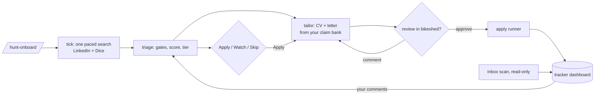

# jobba-hunt

**A job hunt that runs itself politely, and asks you before anything that matters.**

jobba-hunt is a folder you clone. It holds agent skills and plain Node scripts that:

- search LinkedIn and Dice on a schedule, read-only
- score each role against your own rubric
- write a CV and cover letter for every job, using only claims you confirmed
- apply where you said yes
- read your inbox without touching it
- keep a live dashboard you can comment on

It is built for Claude Code. Other agent harnesses can run every step by hand.

---

## How it works



| Stage | What happens | Skill / command |
|---|---|---|
| Onboard | Your CVs and letters become a confirmed **claim bank**. An interview sets your targets, rates, schedule and logins | `/hunt-onboard` |
| Tick | One paced, read-only search per source, about every 30 minutes inside your hours | `npm run tick`, `npm run dice-tick` |
| Triage | Gates (structure, location, seniority, honesty), then a 0-100 score and a tier the script computes | `/hunt-triage` |
| Tailor | A CV and a cover letter for this job, measured against the posting's own terms, claims only. The letter uses one of four approaches | `/hunt-tailor` |
| Review | New tailored documents go to a private bikeshed document. You approve or comment | tracker + `npm run watch` |
| Apply | The runner fills Easy Apply, Dice and ATS forms, and stops on anything it cannot answer | `npm run apply` |
| Inbox | New hunt mail becomes tracker cards with drafts. You do the sending | `npm run mail -- pending` |
| Track | One dashboard: applications, what needs you, the pipeline, loop health, recent activity | `npm run tracker` |
| Loop | All of the above, self-scheduled through your working day | `/loop /hunt-loop` |

## What it will never do

The full rules are in [AGENTS.md](AGENTS.md). In short:

- **Talk on your behalf.** No messages, connection requests, follows, likes or profile edits. You send every email yourself.
- **Make things up.** Every sentence in a CV, letter or answer traces to a claim you confirmed. A missing skill is listed as a gap, never patched in.
- **Apply without a yes.** Only roles you answered "Apply" to, or roles that pass a standing rule you opted into. It never submits twice.
- **Apply twice to one company.** One application per company by default (`config/apply.json` `companies.limit`).
- **Solve a CAPTCHA.** Bot checks are handed to you.
- **Answer the AI question.** If a form asks whether an AI is applying for you, the role comes to you to submit.
- **Push past its limits.** It keeps daily caps and pauses between page loads. Any warning sign halts that source, with no retries.
- **Run while you pause it.** Set the pause in `config/pause.json` and live searches, auto-apply and real submits stop until you lift it.
- **Leak your data.** Everything personal lives in `workspace/`, which git ignores. A pre-commit hook checks staged files for your details.

## Requirements

| | What | How to get it |
|---|---|---|
| Required | git | macOS: `xcode-select --install` (Apple's Command Line Tools, before nvm). Linux: your package manager |
| Required | Node.js 22.13 or newer (`package.json` `engines`; `.nvmrc` says 22) | [nvm](https://github.com/nvm-sh/nvm) (on a new Mac, `touch $HOME/.zshrc` first), [fnm](https://github.com/Schniz/fnm), Homebrew, or your OS package manager. Exact lines: [docs/setup.md](docs/setup.md) step 2 |
| Required | Claude Code, or another agent harness that reads `AGENTS.md` | `curl -fsSL https://claude.ai/install.sh \| bash`, then add `$HOME/.local/bin` to `PATH` ([docs](https://code.claude.com/docs/en/setup)). Needs a paid Claude plan or a Console account |
| Required | macOS, or a Linux desktop with a display | Logins and first dry runs happen in a visible browser window |
| Required | About 0.5 GB of disk | The bundled Chromium (about 350 MB) and `node_modules` (about 150 MB), measured on macOS. A new Mac also needs about 1.3 GB for the Command Line Tools |
| Bundled | Chromium (CloakBrowser), playwright-core, bikeshed CLI, Google Workspace CLI, pdf-lib, pdfjs-dist, docx, marked, fonts | `./bin/bootstrap` installs them into this folder |
| Optional | 1Password CLI (`op`) | Lets the runner create ATS accounts with generated passwords. [Install](https://developer.1password.com/docs/cli/get-started/) |
| Optional | Python 3.8+ | Only for `authentic-prose`'s optional metrics script (stdlib only). System `python3`, or `uv run` |
| Optional | A Gmail connector in your agent | The `bridge` mail adapter, instead of the bundled Google Workspace CLI |
| Optional | firecrawl or Perplexity tools in your agent | Richer company research. Without them, research uses the agent's built-in web search |

Nothing is installed globally. The Chromium download, CLI credentials and your workspace all live inside this folder.

## Quickstart

With git, Node and Claude Code installed ([docs/setup.md](docs/setup.md) steps 1, 2 and 6):

```sh
git clone <your-copy-of-this-repo> jobba-hunt
cd jobba-hunt
./bin/bootstrap        # checks the host, npm ci, downloads Chromium, links skills, runs doctor
claude                 # open the folder in Claude Code (or your harness)
```

Then, inside the agent:

```
/hunt-onboard          # documents, claims, interview, logins, CVs, searches
/loop /hunt-loop       # start the hunt; it schedules itself through your working hours
```

`/hunt-onboard` can be resumed: stop at any phase and it picks up where you left off. Step-by-step instructions for each OS, with checkpoints, are in [docs/setup.md](docs/setup.md).

## Skills

Skills live in `.agents/skills/`. Each one is symlinked into `.claude/skills/` so Claude Code finds it. `npm run skills:link` repairs the links.

| Skill | What it does |
|---|---|
| `hunt-onboard` | Builds your workspace: documents, claim bank, interview, logins, CVs, first probe |
| `hunt-loop` | One loop firing: ticks, triage, tailoring, auto-apply, questions, applies, inbox, tracker, next wakeup |
| `hunt-triage` | Scores new roles against `fit-profile.md` and writes the daily digest |
| `hunt-tailor` | A per-job CV and cover letter from the claim bank, measured against the posting |
| `hunt-kit` | Company research, fit matrix, intro note and checklist for one role |
| `hunt-status` | Pipeline board, due actions, the proposal handoff |
| `hunt-probe` | Tests a new search query set against rules written before the data |
| `hunt-interview` | A brief before a call, a debrief after |
| `hunt-recruiter` | A recruiter's role list: one tailored CV per role, shareable pages |
| `authentic-prose`, `humanizing-prose` | Every outbound sentence goes through `authentic-prose`, in your voice. `humanizing-prose` joins only when a draft still reads machine-made |
| `bs-publish`, `bs-comment`, `bs-folder`, `bs-share` | Publishing and comment handling on bikeshed |

[AGENTS.md](AGENTS.md) "Skills" lists the commands each skill runs and what it needs. The docs index is in [AGENTS.md](AGENTS.md) "Where things are".

## Other harnesses

Every pipeline command is an npm script that prints one JSON object as its last stdout line and documents its exit codes. [AGENTS.md](AGENTS.md) "Command contract" lists the exceptions, and "Skills" maps each skill to its commands, so Codex, OpenCode, Cursor and others can run searches, triage, tailoring and applies. Three features need Claude Code: the self-scheduling loop, push notifications, and the Monitor that keeps the comment watch running. Elsewhere, run one loop firing by hand or from your own scheduler, and poll `npm run watch -- --once`.

## Where your data lives

```
workspace/            gitignored, created by onboarding
  profile/            who you are, preferences, answer bank, voice, standing decisions
  sources/            your original CVs, letters and exports, with their extracted text
  collateral/         claim bank, master CV, CV variants, intro and screening templates
  config/             searches, prefilter, caps, apply channels and the per-company limit,
                      the pause, mail, dashboard, vault
  docs/               profile kits, probe reports
  pipeline/           opportunities, digests, mail threads, interviews, recruiter lists, proposals
  data/               job state, browser profiles, applications, rendered CVs, action log
  .secrets/           CLI credentials (bikeshed, Google Workspace)
```

To keep history, run `npm run onboard -- git-init` to make `workspace/` its own private repository. Point `JOBBA_HOME` at a workspace elsewhere to keep it outside this folder entirely.

## Commands

| Task | Command |
|---|---|
| Health check (prints the fix for each problem; applies nothing) | `npm run doctor` |
| Sign in to bikeshed (in-folder credentials) | `npm run bikeshed -- login` |
| Sign in to Gmail for the `gws` adapter (read-only scope) | `npm run gws -- auth login --scopes https://www.googleapis.com/auth/gmail.readonly` |
| One tick per source | `npm run tick`, `npm run dice-tick` (`--dry-run` plans only) |
| Pause or resume the whole hunt (you only) | Set `paused`, `reason`, `since` and `by` in `workspace/config/pause.json`, with a row in `workspace/profile/decisions.md` |
| Tailor a CV and letter | `npm run tailor -- prepare --job <id>` (then freeze, measure, build, review: `/hunt-tailor` drives it) |
| Use the best archetype CV when no draft beats it | `npm run tailor -- fallback --job <id>` |
| Apply to an approved role | `npm run apply -- --job <id> [--dry-run] [--headed]` |
| Start an apply at a known application page | `npm run apply -- --job <id> --ats-url <https url>` |
| Set an approved role aside, or drop an unsent role | `npm run triage -- hold --id <id> --note "..."`, `npm run triage -- withdraw --id <id> --note "..."` |
| Build all CVs | `npm run cv -- --all` |
| Render an interview brief as a page | `npm run brief -- <brief.md> [--glossary <json>] [--out <html>] [--write-claims]` |
| Dashboard | `npm run tracker -- --dry-run` or `npm run tracker -- --publish` |
| Watch dashboard comments | `npm run watch` |
| Inbox scan | `npm run mail -- pending` |
| What happened | `npm run log -- --since <date, 6h or 2d>` |
| Caps used today | `npm run jobs -- limits`, `npm run dice -- limits` |
| Tests | `npm test` |
| Privacy and portability checks | `npm run check:pii`, `npm run check:portable` |

## Running on another machine

Clone, `./bin/bootstrap`, then bring your workspace: copy the folder, or `git clone` your private workspace repo into `workspace/`. The workspace repo leaves out browser profiles and `.secrets/`, so sign in again on the new host: `npm run jobs -- login`, `npm run dice -- login`, `npm run bikeshed -- login`, and the `gws` sign-in if you use that mail adapter. Job boards dislike sessions that hop between machines, so pick one machine to run the loop. Details: [docs/setup.md](docs/setup.md) "A second host".

## Troubleshooting

| Symptom | Likely cause | Fix |
|---|---|---|
| A tick exits 1 | A guard tripped (sign-in wall, throttling). That source is halted until the daily reset, or 7 days for a checkpoint or authwall. The loop goes on with the other source | For a checkpoint or authwall, sign in by hand (`npm run jobs -- login` or `npm run dice -- login`). Never force it. See [docs/troubleshooting.md](docs/troubleshooting.md) |
| A tick exits 4 | Outside the tick window, or the hunt is paused (`config/pause.json`) | Wait for the window. Only you lift the pause |
| A tick refuses with `not-verified` (exit 2) | The query set has not passed a probe yet | `/hunt-probe` |
| Tracker exit 2 | bikeshed is signed out | `npm run bikeshed -- login` |
| Chromium will not start on Linux | Missing shared libraries | `npm run setup` prints the install lines |
| A CV build fails on fonts | Text fell back to a font outside the bundled set | Remove the character. `npm run doctor` checks `brand/fonts` |

## License

Apache License 2.0. See [LICENSE](LICENSE) and [NOTICE](NOTICE) for bundled third-party material.
