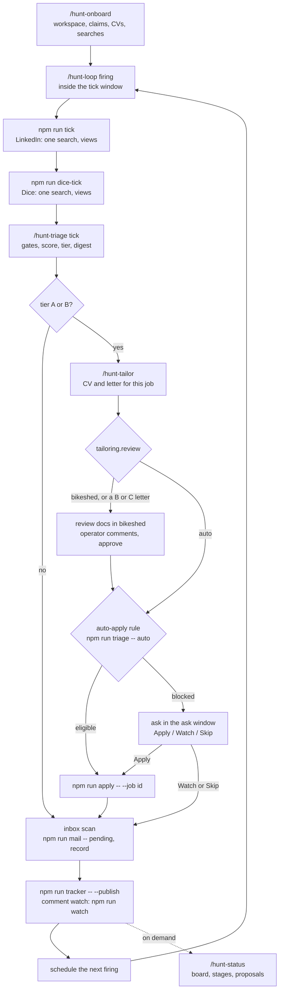

# Runbook

The flow of a live hunt, the decisions only the operator makes, and the procedure for running, checking and recovering it. The rules are in `AGENTS.md`; this file explains the mechanism and links there for a rule. Paths: `scripts/...`, `templates/...` and `docs/...` are repo-relative. `profile/`, `config/`, `collateral/`, `pipeline/` and `data/` are workspace-relative (default `workspace/`, override `JOBBA_HOME`). Cap numbers live in `config/limits.json`; hours, time zone and reset hour in `profile/preferences.json` `schedule`.

## The flow

| Stage | What happens | Command or skill | On disk |
|---|---|---|---|
| Onboard | Workspace from templates, sources ingested, claims confirmed, interview, logins, baseline CVs, probes | `/hunt-onboard` (`docs/setup.md` "Onboard") | `profile/`, `collateral/`, `config/`, `fit-profile.md`, `sources/`, `data/calibration.json`, `data/out/cv/` |
| Tick | One search per source (the canary every `tick.canary_every` ticks), prefilter, views of new keep and review roles | `npm run tick`, `npm run dice-tick` | `data/state/jobs.json`, `data/state/limits-log.json`, `data/raw/YYYYMMDD-HHMM-tick.json` and `-dice-tick.json` (UTC stamp), `data/log/actions.jsonl` |
| Triage | Gates G1-G4 and dimension scores from the fetched description; the script computes the tier | `/hunt-triage tick`, `npm run triage -- pending / record` | `data/triage/pending-*.json`, the results file, `triage` in `jobs.json`, `pipeline/digests/YYYYMMDD-digest.md` |
| Tailor | Terms frozen, CV drafted from claims and measured against the best archetype CV, built with every check; the letter in one of four approaches (`docs/tailoring.md` "Cover letters") | `/hunt-tailor`, `npm run tailor -- prepare / freeze / measure / build --job <id>`, `npm run cover -- --job <id>` | `data/applications/<id>/`: `jd.txt`, `jd.terms.suggested.txt`, `jd.terms.txt`, `tailor.json`, `cv/<slug>.json`, `cover-letter.json`, the letter files; the CV render in `data/out/cv/<id>/` |
| Review | CV and letter each published as a private review document; the operator comments or approves. A B or C letter always waits for this | `npm run tailor -- review --job <id>`, `npm run watch`, `npm run triage -- approve-docs --id <id> --note "..."` | `data/tracker/review-docs.json`; `docs_review` and `docs_approved_at` in `jobs.json` (in `tailor.json` for a role outside the job state) |
| Auto-apply rule | Pursues and approves without a question when nothing blocks. The blockers: "Caps and verification" in `docs/troubleshooting.md`, from `autoApplyBlockers` in `scripts/lib/triage.mjs` and the `auto` command in `scripts/record-triage.mjs` | `npm run triage -- auto --id <id> [--dry-run]` (exit 0 eligible, 2 blockers) | The decision and approval in `jobs.json`, an action-log entry naming the rule |
| Ask | One question per remaining A or B role, up to 4 per call, only inside the ask window | `npm run triage -- decide / approve`; `hold` and `withdraw` on the operator's word | The decision and the operator's words in `jobs.json` |
| Apply | The runner fills the form from the answer bank, attaches the approved CV and letter, submits on a verified channel | `npm run apply -- --job <id> [--dry-run] [--headed]` | `data/applications/<id>/<stamp>-submit/` or `-dry-run/`: `result.json`, screenshots, step files; `pipeline/opportunities/YYYYMMDD-<company>-<role>.md` after a submit |
| Inbox | Headers first, bodies on a hunt signal; the session classifies, matches and drafts; replies become tracker cards | `npm run mail -- pending / record / close` | `pipeline/mail/` thread files and `README.md`, `data/mail/state.json` |
| Tracker | The dashboard re-rendered and published; comments processed as they arrive | `npm run tracker -- --publish --next-check "..."`, `npm run watch` | `data/tracker/tracker.html`, `data/tracker/state.json`, `data/tracker/watch-state.json` |
| Status | The board by stage, due actions, three metrics, stage updates, the proposal handoff | `/hunt-status [--write]`, `npm run log` | Opportunity frontmatter and stage logs, `pipeline/digests/YYYYMMDD-status.md`, `pipeline/proposals/<client>/` |

**`auto` details.** In per-job mode (`preferences.tailoring.cv: per-job`) it uses the job's tailored CV and the coverage of its last measured round. In archetype mode it takes the archetype's CV, or with `auto_apply.cv_pool` the best-covering CV of the role's lane (`cv_slug` in the output). A role whose apply type is `external` counts as verified at approval, provided `external` is in `auto_apply.channels`. The runner checks the ATS it reaches at submit time.

## Decisions the operator owns

No agent and no rule makes these. Standing decisions go into `profile/decisions.md` with the date and the operator's words (`AGENTS.md` "Questions and the loop").

| Decision | When | How it is recorded |
|---|---|---|
| Which claims are true, in which wording | Onboarding claims phase; any new claim later | `collateral/claim-bank.md` (Pending to Claims, with a usable status) |
| Scope: engagement types, location, lanes, floors, tiers, schedule | Onboarding interview; any change later | `profile/preferences.json`, `decisions.md` |
| The fit profile and the calibration roles | Onboarding; any rubric change | `fit-profile.md`, `data/calibration.json` |
| Tailoring mode, review mode and letter mode | Onboarding or later | `preferences.tailoring` `cv`, `review`, `letter`; `decisions.md` |
| Auto-apply on or off, its thresholds, channels and CV pool | Onboarding or later | `config/apply.json` `auto_apply`, `decisions.md` |
| The per-company limit, agencies and aliases | Onboarding or later | `config/apply.json` `companies`, `decisions.md` |
| A standing cap raise | Any time | `config/limits.json`, `decisions.md` (before, after, the operator's words) |
| Each channel's first real submit | After a headed dry run of that channel | `npm run apply -- verify --channel <name> --evidence <run dir>` |
| Apply, Watch or Skip on each A or B role the rule did not approve | The ask window | `npm run triage -- decide`, then `approve` on an unambiguous Apply |
| Hold or withdraw an unsent role | A company-limit question, or the operator's word | `npm run triage -- hold` or `withdraw --id <id> --note "<their words>"` |
| Approving a tailored CV and letter, including every B or C letter | A review-document comment, or "Apply" | `npm run triage -- approve-docs --id <id> --note "<their words>"` |
| Answers to new form questions; required free text | `needs_answers` | `npm run apply -- learn`, `profile/answers.json` |
| Consent boxes (site terms, privacy, SMS, AI analysis) | A form asks and the bank has no answer | `profile/answers.json` |
| CAPTCHAs and bot checks | A headed run waits; otherwise a hand-off | The operator solves it in the window, or submits by hand |
| Forms asking whether an AI applies | Always | The operator submits by hand, then `npm run triage -- applied --id <id>` |
| Reopening a `submit-unverified` role whose screenshot proves nothing was sent | After reading the after-submit screenshot | `npm run triage -- not-sent --id <id> --evidence <png> --note "<their words>"` |
| Every email and message sent | Tracker reply cards | The operator sends; the next scan records it |
| Setting or lifting the pause | Any time | `config/pause.json`, `decisions.md` |
| Cap overrides and early halt clearing | Only on the operator's instruction, for the run they name | `decisions.md`, the digest, the action log ("Halts, the pause and cap overrides") |
| Stage changes after applying (screening, NDA, proposal, won, lost) | On a reply or a call | `/hunt-status` stage update |

## Where a role can stop

| Stop | Meaning | What follows |
|---|---|---|
| Prefilter drop | Title, company, stack, structure, pay floor or location rules, before a view. Dice titles also drop on `ic_title_drop` (`outside-record`); a W2-only Dice title (`dice_w2_title`) drops unless `preferences.engagement.accept` has `w2` | Logged in `jobs.json` (`prefilter.reasons`) |
| Repost | A new id with the same company and title inside `prefilter.json` `repost_window_days` | Kept out of the view queue (`repost_of` in `jobs.json`) |
| Reject | A gate failed, or a pay floor for a hands-on role (IC rate floor, full-time salary floor) | Digest line naming the gate or the floor |
| Tier C | Below `preferences.tiers.b` | Logged only |
| Tailoring gate | Coverage below the best archetype CV, a lint, or the company named | The fallback set (archetype CV plus the job's letter), or the draft revised |
| Watch, Skip | The operator's answer | Stays on the tracker, or leaves it |
| Company limit | `decide pursue` and `approve` exit 1 "company limit: ..."; `auto` blocks | The operator keeps one role; the other is held or withdrawn on their word |
| Held | `triage -- hold` | Back to `watching`; the runner refuses it until it is approved again |
| Withdrawn | `triage -- withdraw` | Skipped for good |
| B or C letter awaiting review | `auto` blocks; the runner refuses a real submit | `approve-docs` on the operator's word |
| Paused | `config/pause.json` `paused: true` | Nothing is viewed or sent until the operator lifts it |
| Refused (apply exit 2) | A gate: not approved, halted, paused, a cap, a sent sibling, an unverified channel | "Apply outcomes" |
| `needs_answers` (exit 4) | A question the bank cannot answer | The operator answers; the runner runs again |
| `manual` (exit 5) | A hand-off: bot wall, CAPTCHA, unsupported site, account portal, a mailed code that did not come, or an AI-applicant question | The operator submits by hand, then `triage -- applied` |
| `closed` (exit 5) | The posting no longer takes applications | Recorded closed. No hand-off |
| `submit-unverified` (exit 6) | Submit clicked, no confirmation seen | Never re-run: `confirm` or `not-sent` from the screenshot |
| Already applied (exit 7) | The platform shows the job as applied | Recorded |

## Before the first live run

| # | Item | Done when |
|---|---|---|
| 1 | Onboarding (`/hunt-onboard`, `docs/setup.md` "Onboard"). Logins, query probes and rubric calibration are onboarding phases | `npm run onboard -- status` shows `"next": null`; `npm run doctor` shows no `FAIL` rows |
| 2 | AI search filter codes | The operator applies the filters by hand in a headed window and copies the URL. `npm run jobs -- search --query "<q>" --headed --pause` keeps the window open until Enter, so run it in a real terminal; it spends one search. Automation never clicks filters |
| 3 | First ticks, headed and watched | `npm run tick -- --headed`, then `npm run dice-tick -- --headed`: each exits 0 with `aborted: null` in the last JSON line (the stderr summary says `guards: none`). The first tick of a source runs its canary |
| 4 | Profile kits | The workspace's `docs/kits/*.md` approved by the operator and entered by hand. Automation never edits a profile |
| 5 | First apply per channel | A `--dry-run --headed` run, the operator checks the step screenshots, then `npm run apply -- verify --channel <name> --evidence <run dir>` (`AGENTS.md` "Platform safety") |

## The loop

Start with `/loop /hunt-loop` in a session that stays open, on a machine that stays awake. The steps follow `.agents/skills/hunt-loop/SKILL.md`.

| Step | What happens | Check |
|---|---|---|
| 1 | `npm run -s tick`: one search, then views of new keep and review roles (at most `tick.views_per_tick`) | The exit code, and `aborted` in the last JSON line. Any abort halts LinkedIn ("Halts, the pause and cap overrides") |
| 1b | `npm run -s dice-tick`: the same for Dice, after step 1, never in parallel. Own profile, caps and halt ("Dice") | The exit code and `aborted`. A Dice abort halts Dice only |
| 2 | `/hunt-triage tick` scores what is pending from both sources and updates today's digest | `pipeline/digests/YYYYMMDD-digest.md` |
| 2b | With `config/apply.json` `auto_apply.enabled`: per new A or B role, `npm run triage -- auto --id <id> --dry-run`, `/hunt-tailor` when only tailoring blocks, then `auto --id <id>`. Exit 0 approves under the rule; exit 2 lists the blockers | Each role is auto-approved (the rule named in its note) or goes to step 3 |
| 3 | Per remaining A or B role: `/hunt-tailor` (`docs/tailoring.md`), or the archetype CV rule when `preferences.tailoring.cv` is `archetype` | The set passed its gates. With review `bikeshed` (and for every B or C letter) its review documents are published |
| 4 | Push notification, then Apply / Watch / Skip, only inside the ask window. A pursue past `config/apply.json` `companies.limit` exits 1 "company limit: `<id> <status>`" | Every remaining A or B role has a decision |
| 4b | Each Apply: `approve-docs` if the set is not approved yet, `npm run triage -- approve --id <id> --cv <pdf> [--cover-pdf <pdf>] --note "<the operator's words>"`, then `npm run apply -- --job <id> [--headed]`; act on the exit code ("Apply outcomes") | Opportunity at `applied` with the confirmation screenshot, or the question or hand-off in front of the operator |
| 4c | Inbox ("Inbox") | Cards on the tracker. No question about mail in the session |
| 5 | `npm run -s tracker -- --publish --next-check "<YYYY-MM-DD HH:MM>"` | Exit 0, or the exit handling below |
| 5b | `npm run watch` under a Monitor for the whole loop, re-armed on expiry. Each new comment is processed when it arrives | An empty thread is the operator still typing: leave it open |
| 6 | Schedule the next firing at the later of the two ticks' `next_tick_at` | Inside the tick window; at most an hour per hop outside it |

**Tracker exits.** 0 published, unchanged or written locally. 1 error, or the privacy guard refused: nothing was published, tell the operator. 2 not signed in to bikeshed: tell the operator once to run `npm run bikeshed -- login`, keep looping. 3 update refused (the document is open in the editor, a suggestion is pending, or the base moved): next firing. 4 open comment threads: act, reply, resolve, publish again.

**Hours.** Ticks run from `schedule.tick_start` to `tick_end` on `schedule.days` in `schedule.tz`, for both sources. Questions follow `AGENTS.md` "Questions and the loop": only from `ask_start` to `ask_end`, only after the firing's ticks and auto-applies ran, and a pending question blocks every later wakeup. Outside the ask window the loop notifies, leaves the roles on the tracker's "Needs you", and asks at the first in-window firing.

**Next firing.** Every tick prints `next_tick_at` (an absolute ISO time) and `next_delay_seconds` (the same instant as an offset from the end of the run).
- Inside the window: a jittered gap from `tick.gap_seconds` in the source's search config.
- `next_tick_at` is never earlier than the last recorded tick plus `ticks_per_day.jitterMin` minutes plus one minute. That keeps the rest of a firing from pulling the next tick inside the gap.
- Outside the window: a hop toward the window, at most an hour, landing 1 to 5 minutes after it opens.
- Paused: an hour from now.

**Rotation** (`config/searches.json`, `config/dice-searches.json`):
- The canary runs every `tick.canary_every` ticks, over its own `canary.tpr_seconds` window.
- The other queries take turns, oldest last ok run first. Each searches back to its own last ok run plus `window.buffer_hours` (`query_runs` in state).
- A blocked or skipped tick costs latency, not coverage, while the gap stays under `window.cap_seconds`. Dice's posted-date filter has three buckets: one, three and seven days.
- `tick.min_interval_hours` is a map of query id to hours: that query runs at most once per N hours. When every query is held, the canary runs.

**Budget:**
- Searches, views, ticks and sweeps per day: `config/limits.json` `linkedin_jobs` and `dice_jobs`.
- `ticks_per_day.jitterMin` is a hard floor between ticks: a tick inside it is refused (exit 2). `jitterMax` is not enforced (it only has to be set for `jitterMin` to apply). `tick.gap_seconds` sets the actual spacing.
- LinkedIn page 2: a query with `scope: "fractional"` reads page 2 whenever page 1 is full. Any other query reads it when page 1 is full, at least `paging.new_share_for_next` of it is new, and the search cap allows.
- Dice ticks never read page 2 (`config/dice-searches.json` `paging` has no `new_share_for_next`).
- Views go newest posted first, at most `tick.views_per_tick` per tick. Unviewed roles stay queued for the next tick.
- Sizing check (the agent's judgment): the ticks in the window, plus page-2 loads, should fit under `searches_per_day`.

**Shared browser profile.** One profile per source under `data/browser/<platform>`. A run that finds the profile busy waits up to 120 s for it (`CLOAK_LOCK_WAIT_MS`), then exits 3 and the loop moves on. A crashed run's stale lock is cleared on the next start. Never `--force-reap` while another run may use the profile. A manual `npm run sweep` spends the same caps: not on a loop day unless the operator asks.

## Weekly review

| Item | Command or rule |
|---|---|
| Board and metrics | `/hunt-status --write` writes `pipeline/digests/YYYYMMDD-status.md` |
| Rubric drift | The operator overrode more than 30% of tiers this week: add those roles to `data/calibration.json`, run `/hunt-triage calibrate` |
| Channel tripwire (the agent's judgment) | Fewer than 3 tier A or B roles a week for 3 weeks running: open another lane or source, through a probe |
| Limiter log | `npm run jobs -- prune` drops entries older than 30 days, for every platform |
| Query health | New roles per query: sum `per_query[].new` for that `id` across the week's `data/raw/*.json`. Survivors per query: roles in `data/state/jobs.json` whose `matched_queries` holds the id and whose `prefilter.verdict` is not `drop`. A query with 0 survivors for 2 weeks goes into the next probe, not straight out of the config |
| Classic queries | `/jobs/search/` already redirects to the AI search and drops `f_WT`, `f_JT` and `sortBy` (`docs/platforms.md` "LinkedIn"). While any query in `config/searches.json` still uses the classic base URL, run `/hunt-probe` to move it to the AI search. No config edit without a probe |
| Account health | Any checkpoint, forced re-verification or unusual platform email this week: halve that platform's caps in `config/limits.json` before the next run |
| Action log | `npm run log -- --since <date>`: every override, halt clearing and verification has a `profile/decisions.md` row |

## Change control

| Change | Required before commit |
|---|---|
| Selector or filter code | A `--headed` confirmation, the selector table in `docs/platforms.md` updated in the same change, `npm test` green. A replay alone is `✓ offline` only |
| Query set | A probe (`docs/query-probe-method.md`) whose decision rules were written before the data, a dated report, then the config edit (`AGENTS.md` "Platform safety") |
| Scope (engagement types, location, lanes) | The same day, a probe that carries the change into the search filters. A scope change that never reaches `config/searches.json` silently misses roles |
| `config/prefilter.json` | A prefilter test covering the case that prompted it |
| `fit-profile.md` | Calibration passes |
| Caps or pacing | Lower any time. Raise only on the operator's explicit word, with a `profile/decisions.md` row (before, after, the operator's words) |
| `config/apply.json` `auto_apply` or `companies`, `preferences.tailoring` | The operator's word, with a `profile/decisions.md` row |
| Channel verification | Only `npm run apply -- verify --channel <name> --evidence <run dir>`, after the operator checked that headed dry run. It writes `verified` or `verified_chrome`, by the driver that ran it |
| CloakBrowser version | Pinned in `package.json` (`cloakbrowser`); the wrapper version fixes the Chromium build (`scripts/cloak-core.mjs`). After a change, `npm run setup` installs the matching build |

## Guards and actions

The last JSON line of a tick, sweep or probe names the guard in `aborted`; the stderr summary prints it as `guards:`. The duration of each halt is in "Halts, the pause and cap overrides".

| Output | Meaning | Action |
|---|---|---|
| `aborted: checkpoint` | The platform challenged the session: a LinkedIn checkpoint or authwall, a Dice challenge page | **Stop that source 7 days.** The operator logs in by hand in a real terminal, halve that source's caps in `config/limits.json`, then one headed, watched tick before the loop restarts |
| `aborted: login-lost` | The session cookie is invalid (Dice: confirmed on the home feed first) | The operator logs in by hand. A same-day re-run is refused by the halt (tick exit 5). Resume after the reset |
| `aborted: blocked` | Dice answered 403 | Dice halted until the reset. Check the query for `"A" OR "B"` |
| `aborted: canary-failed` | The canary returned 0 cards with no empty marker: selector rot or throttling | After the reset: `npm run probe -- --file config/probes/canary-check.json --headed`, then `node scripts/replay-capture.mjs <its capture> --all`. Cards on screen but 0 parsed: re-pin `aiCard` in `JOBS_SEL`. Nothing on screen: throttling. Stop LinkedIn ticks for 3 days (the operator's call) |
| `aborted: canary-empty` | The canary page showed the no-results marker. The canary is never legitimately empty | The endpoint or its params changed. Run `canary-check.json` headed after the reset, compare with the UI, update the config through change control |
| `aborted: throttle-suspect` | Two non-canary searches in a row (counted across ticks) returned 0 cards with no marker | As `canary-failed` |
| `aborted: views-unreadable` | Two job pages in a row had no title or under 100 description characters | After the reset: `npm run jobs -- view --id <id> --headed --capture`, replay it with `node scripts/replay-capture.mjs <capture>`, re-pin the view selectors |
| `aborted: unknown-status:<x>` | A reader returned a status the guards do not know: the run fails closed | Halted until the reset. Capture the page, replay it, fix the reader |
| `profileBusy` (exit 3) | Another process held the browser profile past the lock wait | Next firing. Not counted against a cap |
| `aborted: browser-unavailable`, `browser: unavailable` (exit 3, chrome driver) | The agent's Chrome stopped answering a bridge request in time, failed it, or its copied envelope failed the checks twice | No halt. Check `/chrome` (Reconnect extension) and run the next firing. A page load counts only if the agent made it |
| `cap: chrome-session-unconfirmed` (exit 2, chrome driver) | The source's sign-in in Chrome was never confirmed, or a login-lost abort cleared it | The operator signs in to the board in Chrome, then `npm run -s browser -- start jobs -- whoami` (or `dice`) |
| `cap: chrome-needs-bridge` (exit 2, chrome driver) | A browser command was started directly | Start it through the bridge: `npm run -s browser -- start <command> -- <args>` |
| `halted` (tick and dice-tick exit 5, sweep exit 2) | An earlier abort set `halt_until` | Wait. Fix the cause per its row. Only the operator clears a halt early |
| Exit 4, `closed: true` | Outside the tick window | Normal. The loop hops toward the window |
| Exit 4, `paused: true` | `config/pause.json` is paused | Inbox and tracker only, next firing in an hour |
| Exit 2, `cap: not-verified` | The query set has no probe behind it | `/hunt-probe`, then `npm run probe -- --mark-verified <result>` |
| Exit 2, `cap: ticks_per_day` with "Jitter gap" | The last tick was less than `jitterMin` minutes ago | Clears by itself at `nextAllowedAt`. Schedule from `next_tick_at` |
| Exit 2, `cap: <name>` with "Limit reached" | A daily cap is used up | Wait for the reset. No force flag; an override only on the operator's word ("Halts, the pause and cap overrides") |
| `budget_exhausted: true` | Searches or views ran out mid-run | Normal. The remaining views wait for the next tick |

## Apply outcomes

`npm run apply -- --job <id>` exits as follows (`scripts/apply-job.mjs` header). Under the chrome driver it runs as `npm run -s browser -- start apply -- --job <id> [--dry-run]` and exits the same way, plus 3 with `browser: unavailable` when the browser stops answering before Submit (nothing sent; after Submit it is 6). A channel needing the cloakbrowser driver's own steps comes back 5 with `driver_hint: cloakbrowser` (`docs/platforms.md` "Applying under the chrome driver"). Never wrap it in a shell `timeout` and never kill it early (`AGENTS.md` "Platform safety"): use the harness's own tool timeout, in the background when the run may wait for the operator.

| Exit | Outcome | Action |
|---|---|---|
| 0 | `submitted`, or `dry-run-complete` | Key the opportunity file on `outcome: submitted` only: `templates/opportunity.md`, `stage: applied`, `applied_on` today, no follow-up date, with the evidence screenshot. A dry run: show the operator the step screenshots |
| 1 | `error` | Read `detail`. A LinkedIn checkpoint or authwall, a lost LinkedIn login, or a Dice 403, challenge page or confirmed sign-out also set that source's halt: act as "Guards and actions". A run that reached a company site recorded `ats_url`; the next run starts there |
| 2 | Refused | The table below. Gate refusals carry `reason`; refusals inside a run carry `outcome: refused` and `detail` |
| 3 | Profile busy | Next firing |
| 4 | `needs_answers` | Ask the operator each listed question, store each with `npm run apply -- learn --label "..." --answer "..."`, run again. `prefilled-unvetted`: a prefilled value is not an answer; ask. `optional-text`: draft a lean answer from claims, write it to `data/applications/<id>/answers.json` `answers`, run again |
| 5 | `manual` | A hand-off: bot wall, CAPTCHA, unsupported site (a work-sample platform too), account portal (a sign-in, a new account or an email to verify), a mailed code that did not come. Hand it to the operator with the `ats_url`, CV and letter; after they submit, `npm run triage -- applied --id <id>` |
| 5 | `manual`, `reason: ai-applicant-question` | The form asks whether an AI applies. The runner never answers it and `learn` refuses it. The operator submits by hand, then `triage -- applied` |
| 5 | `closed` | The posting no longer takes applications. Recorded closed; no hand-off |
| 6 | `submit-unverified` | **Never re-run.** Read the `after-submit` screenshot. A site confirmation: `npm run triage -- confirm --id <id> --evidence <png>`. Proof that nothing was sent, with the operator's words: `npm run triage -- not-sent --id <id> --evidence <png> --note "..."`, after which one more run is allowed. Otherwise the operator checks the platform's applied list or the receipt email |
| 7 | `already-applied` | Recorded. Nothing to do |

**Exit 2 reasons:**

| Reason or detail | Meaning | Action |
|---|---|---|
| `not-pursued` | No `pursue` decision | Record the operator's decision first |
| `not-approved` | A real submit without `triage -- approve` | `approve` only after an unambiguous Apply |
| `already-applied` | The job is `submitted`, `submitted-by-hand`, `already-applied` or `submit-unverified` | Never re-run |
| `submit-pending` | An earlier run asked for Submit (`submit_pending` in the job state, `submit-requested.json` in its run folder) and never finished: whether it went out is unknown | `npm run apply -- recover --job <id>` records it `submit-unverified`. Then as exit 6: the screenshot or the operator decides, never a retry |
| `paused: <reason>` | The pause holds every real submit | Wait for the operator to lift it. Dry runs still run |
| `same-company: <id> <status>` | Another application at this company was already sent (`companies.limit`) | Never re-run. Tell the operator |
| `halted until <time>`, `Dice halted until <time>` | That source's halt. Dry runs are refused too | Wait for `halt_until` |
| `no answer bank ...`, `no CV ...`, `CV not found`, `intro note not found`, `cover letter PDF not found` | A missing input | Fix the path or the bank, run again |
| `letter approach B needs the operator's review` (or C) | The tailored set is not approved | `approve-docs` on the operator's word |
| `... apply_page_loads_per_day cap reached`, `... applications_per_day cap reached` | A daily apply cap (`linkedin_apply`, `dice_apply`, `ats_apply`) | Wait for the reset at `schedule.reset_hour` (daily, business day or not). An override only on the operator's word |
| `channel <name> is not verified` | The channel, or the ATS a LinkedIn or Dice link led to, has no verified dry run | `npm run apply -- --job <id> --dry-run --headed`, show the operator the screenshots, then `npm run apply -- verify --channel <name> --evidence <run dir>` only on their yes |

**Start points.** A company-site role whose last run recorded its application URL starts there (`--via-linkedin` takes the LinkedIn path instead). `--ats-url <https url>` starts one run of a LinkedIn job at a known application page; a LinkedIn or Dice URL is ignored.

**Evidence.** Each run writes `data/applications/<id>/<stamp>-submit/` or `<stamp>-dry-run/`: `result.json`, numbered screenshots, and per step `step<N>-dialog.html` (LinkedIn Easy Apply), `step<N>-page.html` (Dice Easy Apply), or `step<N>-fields.json` and `step<N>-fields-filled.json` (a company-site form).

## Halts, the pause and cap overrides

**Halts.** Any abort halts that source (`AGENTS.md` "Platform safety"). The halt lives in `data/state/jobs.json`: `halt_until` for LinkedIn, `sources.dice.halt_until` for Dice. One source's halt never stops the other.

| Abort | Halted until |
|---|---|
| `checkpoint` (LinkedIn checkpoint or authwall, Dice challenge page) | 7 days later |
| Any other abort | The next `schedule.reset_hour` in `schedule.tz` |

What sets a halt: an aborted tick, dice-tick, sweep or live probe (exit 1; a probe stopping on its own cap check halts nothing), and the apply runner (exit 1) on a LinkedIn checkpoint, authwall or lost login, or a Dice 403, challenge page or confirmed sign-out.

| Command | While its source is halted |
|---|---|
| `tick`, `dice-tick` (and `dice-tick --sweep`) | Exit 5, `halted: true` |
| `sweep` | Exit 2, `halted: true` |
| `probe` (live) | Exit 5. Its `--dry-run` and `--mark-verified` still run |
| `jobs` and `dice` `search`, `view` | Exit 1, `halted: true` |
| `apply` | Exit 2, real submit and dry run alike |
| `login`, `whoami`, `limits` | Run: recovery needs them |

- **Expiry:** the first live tick or sweep of that source that ends without a new abort clears an expired halt and logs `halt.cleared`.
- **Early clearing:** only on the operator's explicit instruction in the session, never on an agent's judgment: `npm run jobs -- clear-halt --note "<their words>"` for LinkedIn, `npm run dice -- clear-halt --note "<their words>"` for Dice. It clears that source alone and logs `halt.cleared` (actor `user`). Each clearing also gets a digest line and a `profile/decisions.md` row.
- **Loop stop:** both sources halted for more than a day.
- **After a checkpoint:** the operator logs in by hand, halve that source's caps, one headed, watched tick, then the loop.

**The pause.** `config/pause.json` `{paused, reason, since, by}` stops the whole hunt. Only the operator sets or lifts it, each time with a `profile/decisions.md` row. A halt is checked before the pause, except in the apply runner, whose gate checks the pause first.

| Command | While paused |
|---|---|
| `tick`, `dice-tick` (live, and `--sweep`) | Exit 4, `closed: true, paused: true`, nothing viewed, `next_tick_at` an hour on. A `--dry-run` still plans |
| `sweep` | Exit 4, `paused: true`. A `--dry-run` still plans |
| `probe` (live) | Exit 4. Its `--dry-run` and `--mark-verified` still run |
| `jobs` and `dice` `search`, `view` | Exit 1, `paused: true` |
| `login`, `whoami`, `limits` | Run |
| `triage -- auto` | Exit 2, blocker `submissions paused: <reason>` |
| `apply` | A real submit exits 2, `paused: <reason>`. Dry runs run |
| `mail`, `tracker`, `watch` | Run. The loop runs the inbox and the tracker only, then schedules the next firing in an hour |

**Cap overrides.** Only on the operator's explicit instruction in the session, and only for the run they name (`AGENTS.md` "Platform safety"). Every other cap stays in force. Never a force flag, a same-day re-run after an abort, parallel searches or a retry loop. Record each override in `profile/decisions.md` and the digest.

**Read caps** (`linkedin_jobs`, `dice_jobs`: searches, views, ticks, sweeps):
1. Copy `data/state/limits-log.json` to a temporary file.
2. In the copy, remove only that cap's entries for today (that `platform` and `actionType`, since today's reset).
3. Run the named command with `JOBBA_LIMITS_LOG` pointing at the copy.
4. Merge the run's new entries into the real log, each with `cap_override` set to the reason. The tracker lists them under "Cap overrides today".

**Apply caps** (`linkedin_apply`, `dice_apply`, `ats_apply`): add an entry to `data/state/cap-overrides.json`, a JSON array of `{date, platform, action, max, by}`.
- `date` is today as `YYYY-MM-DD` in `schedule.tz`; only today's date matches.
- `action` is `applications_per_day` or `apply_page_loads_per_day`; `max` is the limit for today.
- Every use past the standing cap is tagged `cap_override` in the limiter log and logged as `cap.override` in the action log.

## State recovery

| Lost file | Cost | Recovery |
|---|---|---|
| `data/state/jobs.json` | Old roles are seen again, and the halts are lost. The pipeline itself lives in `pipeline/opportunities/` | Before the next run, read the last `halt.set` entries in `data/log/actions.jsonl` (`npm run log -- --since 7d`) and wait out any halt still running. Triage re-scores what is new |
| `data/state/limits-log.json` | Today's cap usage is forgotten | Run nothing more until the next reset |
| `data/state/cap-overrides.json` | Today's apply-cap overrides are gone; the standing caps apply | Re-add today's entry only on the operator's word |
| `data/tracker/state.json` | The last published hash | The next publish sends the page once. Document ids stay in `config/tracker.json` |
| `data/mail/state.json` | The scan position | Set `config/mail.json` `first_scan_after` to the last scan date before the next `mail -- pending` |
| `data/log/actions.jsonl` | The audit trail | Append-only. Nothing replays it |

**Backup.** `npm run onboard -- git-init` makes the workspace its own git repository, `data/` included, apart from the paths in `templates/workspace/.gitignore`: `data/browser/`, `data/raw/`, `data/captures/`, `data/applications/*/*-dry-run/` and `.secrets/`. That repository holds personal data and must stay private.

## Dice

Dice runs in every firing after LinkedIn, for leadership and for hands-on senior, lead and principal roles (Lane H, `fit-profile.md`).

**Login.** The automation profile is `data/browser/dice`. The operator signs in by hand with `npm run dice -- login`: a headed window that closes by itself once signed in (10 minutes at most). `npm run dice -- whoami` checks it. Profile edits happen in a normal browser, never in the automation profile.

**Search URL** (`scripts/lib/dice-url.mjs`, `config/dice-searches.json`): parameters in `docs/platforms.md` "Dice". Never `"A" OR "B"`: the firewall answers 403 and the URL builder refuses it. The posted-date filter takes the smallest of the one-, three- and seven-day buckets that covers the query's window.

**Guards (Dice only):**

| Signal | Status | Action |
|---|---|---|
| HTTP 403, or "403 Forbidden", "access denied", "request blocked" | `blocked` | Abort. Dice halted until the reset |
| A challenge page ("just a moment", "verify you are human", captcha, unusual traffic) | `checkpoint` | Dice halted 7 days. The operator logs in by hand, then the Dice caps are halved |
| Signed out | `login` | Halts only after the home feed confirms it: Dice often serves its public header to a live session. Not confirmed: recorded as a suspect page, no halt. Confirmed: `npm run dice -- login` |
| `job-search-no-results` | `empty` | Legitimate, and moves the query window. On the canary it aborts (`canary-empty`) |
| 0 cards, no marker | `suspect` | On the canary it aborts (`canary-failed`). Two in a row abort (`throttle-suspect`) |

**Caps and pacing.** Caps: `config/limits.json` `dice_jobs` and `dice_apply`, reset at `schedule.reset_hour`. A company site reached from Dice counts against `ats_apply`. Pacing is Dice's own: `config/dice-searches.json` `pacing`, `tick.gap_seconds` and `tick.views_per_tick`.

**Prefilter and triage.** A Dice title passes on `title_leadership` or `title_ic`. `ic_title_drop` drops support desks and other titles outside the record (`outside-record`). A W2-only title (`dice_w2_title`) beats the badges: it goes to review as `w2-only` when `preferences.engagement.accept` has `w2`, and drops otherwise. G1 reads the contract badges against `preferences.engagement.accept`. G2 reads the job page's workplace badge, never the search filter. The digest shows the posted rate.

**Manual sweep** (the operator's instruction only): `npm run dice-tick -- --sweep [--views <n>] [--headed]` runs the canary and every configured query, reads page 2 of each `scope: "dice"` query when page 1 is full, then views kept roles up to `--views` (default 80). It skips the hours check. It checks and records `dice_jobs` `sweeps_per_day` and `searches_per_day`. The guards, the Dice halt and the pause still apply. Its snapshot is `data/raw/YYYYMMDD-HHMM-dice-sweep.json`.

**Query probe.** A probe file with `"source": "dice"`: `npm run probe -- --file config/probes/<file>.json` (headed for the first run; `--into-state` also writes the cards and views into state for a one-time scan), then `npm run probe-report -- data/probes/<file>`. Its verdicts fill `queries`, and `npm run probe -- --mark-verified data/probes/<file>` sets `verified: true`. Until then `dice-tick` exits 2 (`cap: not-verified`) and the loop treats it as a no-op.

**Dice Easy Apply (`dice-easy`).** The runner opens the wizard and fills it from `profile/answers.json`. It replaces the resume with the approved CV for this application only and puts the letter in the Cover Letter slot, never a CV. It unticks follow, subscribe and job-alert opt-ins, and hands off (exit 5) while one stays ticked. It checks the review cards, and after the submit reads the profile resume to confirm it did not change. A link off Dice goes down the ATS path: an unverified ATS is refused (exit 2) until verified, and only an unknown site is a hand-off (exit 5). Details: `docs/platforms.md` "Dice Easy Apply (channel `dice-easy`)".

## Inbox

Design: `docs/inbox-scan-design.md`. Adapter: `config/mail.json` `adapter` (`gws`, `bridge` or `none`). Runs in every firing (loop step 4c). Mail rules: `AGENTS.md` "Mail (any adapter)".

| Step | Command | Writes |
|---|---|---|
| Export | `npm run -s mail -- pending` | `data/mail/pending-<stamp>.json`: signal mail with bodies, plus the operator's own replies. At most `max_per_run` messages a firing, oldest first. A security notice's body is never read. With nothing to judge it saves `data/mail/state.json` and keeps no file. `bridge`: `pending`, `pending --headers <response>` and `pending --bodies <response>`, each exit 6 `needs_fetch` until done (`docs/adapters.md`) |
| Judge | The session classifies, matches and drafts. `match` is `sure`, `probable` or `none` | `data/mail/results-YYYYMMDD-HHMM.json` |
| Record | `npm run -s mail -- record --file <results> --sent <pending file>` | Thread files and `README.md` in `pipeline/mail/`, opportunity stage-log rows (a probable match is noted as such), channel contact rows, then the scan state (never backwards). Deletes the pending file |
| Close | `npm run -s mail -- close --thread <id> --status closed\|no-reply --note "..."` | The thread's status and note |

**Cards.** A probable match links "Probably `<title>`" on its card, never the role itself. A platform-message card ("Read it on `<board>`") clears after `config/tracker.json` `read_card_days` business days (default 5).

| Problem | Fix |
|---|---|
| `pending` exits 2 | The mail reader is not signed in (gws: `npm run gws -- auth login --scopes https://www.googleapis.com/auth/gmail.readonly`). Tell the operator once; the loop carries on without mail |
| `pending` exits 6 (`bridge`) | Fulfil the named request with the connector's read tools, write the named response file, then run the `next` command from the output (`docs/adapters.md` "The bridge handshake (inbox scan)") |
| `pending` exits 1, or lists `thread_errors` | Exit 1: the error is in the JSON; report it once and carry on. A thread error is a thread the mailbox no longer returns: close its card with `mail -- close` |
| A hunt email never shows up | Check its sender and subject against `config/mail.json`. Add a staffing domain to `hunt_senders`. Never add a client domain there |
| Mail that should never be opened was opened | Add the sender or domain to `never_open`, then delete the pending file. Record it as `ignore` |
| A card stays after the operator replied | Sent detection reads the operator's mail after the newest email on the thread, so a reply in another thread is missed. Close it with `mail -- close` |
| `record` exits 1 | It lists each thread and the reason and writes nothing: a rate figure, a semicolon, an em dash, an unknown or unusable claim, a kind that needs or takes no draft, a bad `match`, a hands-on role under the IC floor, a sent reply for an unknown thread, or a probable match against an existing opportunity file. Fix the results file and run again |

## Data files

| Path | Content |
|---|---|
| `data/state/jobs.json` | One record per job id: sightings, `matched_queries`, prefilter, detail, triage, application and attempts. Also the LinkedIn halt and loop state, and `sources.dice` for Dice |
| `data/state/limits-log.json` | Every page load and application, read by the caps (`JOBBA_LIMITS_LOG` points elsewhere for a read-cap override) |
| `data/state/cap-overrides.json` | Dated apply-cap overrides, `{date, platform, action, max, by}` |
| `data/browser/<platform>` | The signed-in browser profiles: `linkedin`, `dice` |
| `data/raw/YYYYMMDD-HHMM-sweep.json`, `-tick.json`, `-dice-tick.json`, `-dice-sweep.json` | Per-run snapshot (UTC stamp): the pick, `aborted`, `halt_until`, `per_query` (`ids`, `new`, `seen`, status, window), views, `viewed` |
| `data/applications/<job_id>/` | Tailoring (`tailor.json`, `jd.txt`, `jd.terms.suggested.txt`, `jd.terms.txt`, `cv/<slug>.json`, `cover-letter.json`, `cover-letter.txt`, the letter's HTML, PDF and PNG), job-scoped `answers.json`, and one folder per runner run (`<stamp>-submit/`, `<stamp>-dry-run/`) with `result.json`, screenshots and the step files |
| `data/triage/` | Pending-triage exports, scored results, blind calibration copies |
| `data/calibration.json` | The calibration roles and expected verdicts |
| `data/tracker/` | `tracker.html`, `state.json` (last published hash), `watch-state.json`, `review-docs.json` (the review documents per job) |
| `data/letters-bikeshed/state.json` | The private documents of sent letters |
| `data/mail/` | Pending, results, `requests/` and `responses/` (`bridge`), scan state |
| `data/captures/` | HTML and screenshots from `--capture`. They show the signed-in page: sanitize before any reuse |
| `data/probes/` | Probe results: every card, final URLs, views |
| `data/log/actions.jsonl` | The action log (`npm run log`) |
| `data/out/cv/` | Rendered CVs: `share/` and dated folders, plus `<id>/` per tailored job and one folder per recruiter list |
