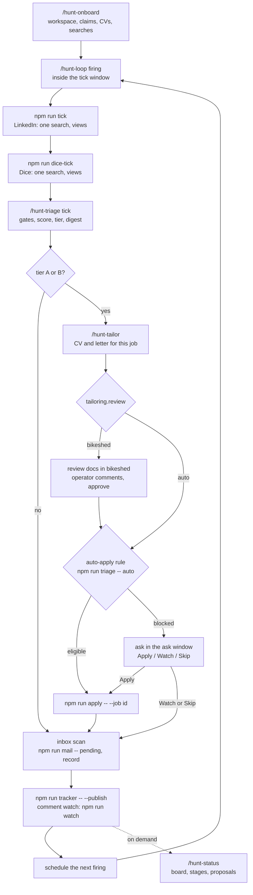

# Workflow

The end-to-end flow of a hunt, the decisions only the operator makes, and what each stage leaves on disk. Operating detail (caps, guards, recovery): `docs/runbook.md`. Paths: repo-relative (`scripts/...`) or workspace-relative (`profile/`, `config/`, `collateral/`, `pipeline/`, `data/`).

## The flow

## Stages

| Stage | What happens | Command or skill | On disk |
|---|---|---|---|
| Onboard | Workspace from templates; sources ingested; claims confirmed; interview; logins; baseline CVs; probes | `/hunt-onboard` (`docs/onboarding.md`) | `profile/`, `collateral/`, `config/`, `fit-profile.md`, `sources/`, `data/calibration.json`, `data/out/cv/` |
| Tick | One search per source (the canary every `tick.canary_every` ticks), prefilter, views of new keep/review roles | `npm run tick`, `npm run dice-tick` | `data/state/jobs.json`, `data/state/limits-log.json`, `data/raw/YYYYMMDD-HHMM-tick.json`, `data/log/actions.jsonl` |
| Triage | Gates G1-G4, dimension scores; the script computes the tier | `/hunt-triage tick`, `npm run triage -- pending / record` | `data/triage/pending-*.json`, `data/triage/results-*.json`, triage in `jobs.json`, `pipeline/digests/YYYYMMDD-digest.md` |
| Tailor | Terms frozen, CV drafted from claims, measured against the best archetype CV, built with every check, letter (approach A) built | `/hunt-tailor`, `npm run tailor -- prepare / freeze / measure / build --job <id>`, `npm run cover -- --job <id>` | `data/applications/<id>/`: `jd.txt`, `jd.terms.txt`, `tailor.json`, `cv/<slug>.json`, `cover-letter.json`, the letter files; the CV render in `data/out/cv/<id>/` |
| Review | CV and letter each published as a private review document; the operator comments or approves | `npm run tailor -- review --job <id>`, `npm run watch`, `npm run triage -- approve-docs --id <id>` | `data/tracker/review-docs.json`, `docs_review` and `docs_approved_at` in `jobs.json` |
| Auto-apply rule | Approves without a question when the rule holds: enabled, score, gates, verified listed channel, CV coverage, approved documents (per-job with bikeshed review) | `npm run triage -- auto --id <id>` (exit 0 eligible, 2 blockers) | The decision and approval in `jobs.json`, an action-log entry naming the rule |
| Ask | One question per remaining A/B role, up to 4 per call, only inside the ask window | `npm run triage -- decide / approve` | The decision and the operator's words in `jobs.json` |
| Apply | The runner fills the form from the answer bank, attaches the approved CV and letter, submits on a verified channel | `npm run apply -- --job <id> [--dry-run] [--headed]` | `data/applications/<id>/<run>/`: `result.json`, screenshots; `pipeline/opportunities/YYYYMMDD-<company>-<role>.md` after a submit |
| Inbox | Headers first, bodies on a hunt signal; the session classifies, matches and drafts; replies become tracker cards | `npm run mail -- pending / record / close` | `pipeline/mail/` thread files and `README.md`, `data/mail/state.json` |
| Tracker | The dashboard re-rendered and published; comments processed as they arrive | `npm run tracker -- --publish --next-check "..."`, `npm run watch` | `data/tracker/tracker.html`, `data/tracker/state.json`, `data/tracker/watch-state.json` |
| Status | The board by stage, due actions, three metrics; stage updates; proposal handoff | `/hunt-status [--write]`, `npm run log` | Opportunity frontmatter and stage logs; `pipeline/digests/YYYYMMDD-status.md`; `pipeline/proposals/<client>/` |

## Decisions the operator owns

No agent and no rule makes these. Standing decisions go into `profile/decisions.md` with the operator's words.

| Decision | When | How it is recorded |
|---|---|---|
| Which claims are true, in which wording | Onboarding claims phase; any new claim later | `collateral/claim-bank.md` (pending to confirmed) |
| Scope: engagement types, location, lanes, floors, tiers, schedule | Onboarding interview; any change later | `profile/preferences.json`, `decisions.md` |
| The fit profile and the calibration roles | Onboarding; any rubric change | `fit-profile.md`, `data/calibration.json` |
| Tailoring mode and review mode | Onboarding | `preferences.tailoring`, `decisions.md` |
| Auto-apply on or off, and its thresholds | Onboarding or later | `config/apply.json` `auto_apply`, `decisions.md` |
| Each channel's first real submit | After a headed dry run of that channel | `npm run apply -- verify --channel <name> --evidence <run dir>` |
| Apply, Watch or Skip on each A/B role the rule did not approve | The ask window | `npm run triage -- decide`, then `approve` on an unambiguous Apply |
| Approving a tailored CV and letter | Comment on the review documents | `npm run triage -- approve-docs` |
| Answers to new form questions; required free text | `needs_answers` | `npm run apply -- learn`, `profile/answers.json` |
| Consent boxes (site terms, privacy, SMS, AI analysis) | When a form asks and the bank has no answer | `profile/answers.json` |
| CAPTCHAs and bot checks | A headed run waits; otherwise a hand-off | The operator solves it in the window, or submits by hand |
| Forms asking whether an AI applies | Always | The operator submits by hand, then `npm run triage -- applied` |
| Every email and message sent | Tracker reply cards | The operator sends; the next scan records it |
| Cap overrides and early halt clearing | Only on the operator's instruction, for the run named | `decisions.md`, digest, action log |
| Stage changes after applying (screening, NDA, proposal, won, lost) | On a reply or a call | `/hunt-status` stage update |

## Where a role can stop

| Stop | Meaning | What follows |
|---|---|---|
| Prefilter drop | Title, company, stack, floor or location rules before a view | Logged in `jobs.json` with the reasons |
| Reject | A gate failed | Digest line naming the gate |
| Tier C | Below `preferences.tiers.b` | Logged only |
| Tailoring gate | Coverage below the best archetype CV, a lint, or the company named | The archetype CV is used, or the draft revised |
| Watch, Skip | The operator's answer | Stays on the tracker, or leaves it |
| `needs_answers`, `manual` | A question to answer, or a hand-off | The operator answers or submits by hand |
| `submit-unverified` | Submit clicked, no confirmation seen | Never re-run; checked against the screenshot or the platform |
